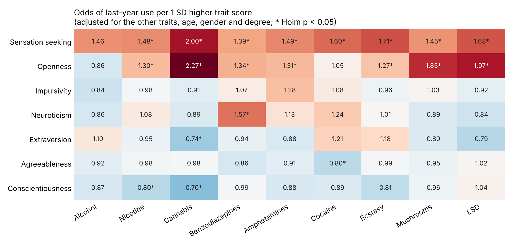

# Personality and Drug Use

Do Big Five personality traits, impulsivity, and sensation seeking predict use of hallucinogens (LSD, mushrooms) differently from use of alcohol, nicotine, stimulants or benzodiazepines?



## Key findings

**- Sensation seeking** is correlated with last-year use of every substance studied. A person one standard deviation higher than the mean on sensation seeking has 1.39 to 2.00 times the odds of having used it in the last year, after adjusting for the other traits, age, gender and education.

**- Openness to experience** distinguishes hallucinogens and cannabis from the rest. The odds ratio is 1.97 for LSD, 1.85 for mushrooms, and 2.27 for cannabis, against 1.05 for cocaine and 0.86 for alcohol.

**- Neuroticism** is linked with one substance: benzodiazepines (odds ratio 1.57), which are prescription sedatives used for anxiety.

**- Impulsivity** scores lower when sensation seeking is included in the model. The two scores correlate at r = 0.62, and the only drug in which impulsivity's odds ratio > 1.1 is for amphetamines (1.28, not significant after correction).

**- 20 of the 63 trait effects (7 traits x 9 substances)** stay significant after a Holm correction for multiple testing.

## Data

UCI Machine Learning Repository, [Drug Consumption (Quantified)](https://archive.ics.uci.edu/dataset/373/drug+consumption+quantified), DOI 10.24432/C5TC7S, licensed CC BY 4.0. It was collected by Elaine Fehrman, Vincent Egan and Evgeny Mirkes through an anonymous online survey. The file has 1,885 adult respondents (1,044 UK, 551 USA) with:

- Personality scores: NEO-FFI-R (neuroticism, extraversion, openness, agreeableness, conscientiousness), BIS-11 (impulsivity) and ImpSS (sensation seeking). They are supplied already standardized, so odds ratios are per 1 SD.
- Age group, gender, education, country and ethnicity, supplied as numeric codes that `scripts/01_decode.py` converts back to labels.
- Use of 18 substances on a 7-level scale, from never used to used in the last day.

The survey includes Semeron, a drug that doesn't exist, to catch over-claiming. 8 respondents said they had used it, and they are excluded, which leaves 1,877.

## Method

**- Outcome:** Used in the last year or more recently (CL3 to CL6) against Not Used, for nine substances: alcohol, nicotine, cannabis, benzodiazepines, amphetamines, cocaine, ecstasy, mushrooms and LSD.

**- Model:** one logistic regression per substance with all seven traits together, plus age group (18-24, 25-34, 35-44, 45+), gender and holding a university degree. The 45+ band combines three groups because the 55-64 and 65+ groups (111 people) had too few users of some drugs for the models to converge.

**- Checks:** variance inflation factors are all under 2 (largest 1.91, sensation seeking). The R script refits every model with `glm()` and matches all 63 Python odds ratios to three decimals.

**- Descriptives:** last-year prevalence per substance and, for each trait, the standardized difference (Cohen's d) between last-year users and people who never used the substance.

## Limitations

- The sample is a **convenience sample** recruited online, mostly in the UK and USA, and is not representative of any population. Its rates of drug use are far higher than in national surveys (20% used LSD in the last year).
- The data is **cross-sectional**, so a trait being linked with use doesn't show that the trait causes use.
- Use is **self-reported.** The Semeron check catches only the most obvious over-claiming.
- **"Used in the last year"** mixes one-time use with heavy use.

## Files

- `data/raw/drug_consumption.data`: the UCI file, unchanged
- `scripts/01_decode.py`: decodes the numeric codes and writes `data/processed/respondents.csv` and `use_long.csv`
- `scripts/02_analysis.py`: prevalence, trait profiles, collinearity check and the logistic regressions
- `scripts/03_models.R`: R replication of the regressions
- `scripts/04_charts.py`: the heatmap and the Tableau exports
- `results/`: `prevalence.csv`, `trait_profiles.csv`, `vif.csv`, `logit_odds_ratios.csv`, `r_logit_odds_ratios.csv`
- `tableau/`: `respondents.csv`, `use_long.csv` and `odds_ratios.csv` for the Tableau dashboard

## How to run

```
pip install pandas numpy statsmodels matplotlib
python scripts/01_decode.py
python scripts/02_analysis.py
Rscript scripts/03_models.R
python scripts/04_charts.py
```

## Tools

Python (pandas, statsmodels, matplotlib), R (base `glm`), Tableau.

## Author

Michael Goldenitz. [LinkedIn](https://www.linkedin.com/in/michael-goldenitz/) · [GitHub](https://github.com/mgoldenitz)
